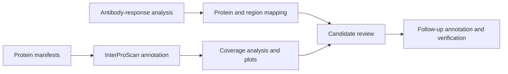

# StrepA · Computational Research

Code supporting the **Streptococcus pyogenes and PANS-associated antibody research** project by **Sara Teitelbaum and Evan Ho**.

[Get started](#get-started) · [Methods & reproduction](docs/reproduction.md) · [Source inventory](docs/source-inventory.md) · [Archive coverage](docs/completeness.md) · [MIT license](LICENSE)

## About the project

This repository preserves the computational work used to investigate hypothetical proteins and follow up candidate regions in the StrepA research project. It includes annotation-coverage analysis, Hummingbird job scripts, result verification, supplementary prediction scripts, and spreadsheet-generation code.

The research includes a **2,015-protein annotation analysis**, a **19-candidate review**, a **three-priority review**, and a later **66-protein annotation run**. These refer to different analysis scopes. Their precise relationships and the final candidate-selection provenance are still being reconciled; the numbers should not be read as interchangeable cohorts.

**Archive status:** this initial code archive preserves the sources recovered so far. The [coverage register](docs/completeness.md) identifies missing upstream, BLAST, and figure-generation code. Computational annotations alone do not establish biological function or disease causality.

## Explore

| Workstream | Entry point | Included |
| --- | --- | --- |
| Annotation coverage | [Portable Python analysis](analysis/annotation_coverage/graph_2015_hp_interproscan.py) | Two small inputs, tested dependencies, plotting and summary statistics |
| Original 2,015-protein analysis | [Recovered source](historical/pdf_recovered/analyze_hp_matches.py) | 347 lines reconstructed from the original PDF listing; [recovery notes](historical/pdf_recovered/README.md) |
| October InterProScan run | [Run scripts](historical/hummingbird/outputs/Hummingbird_results_20261004/scripts) | SLURM submission, configuration, preflight, and final verification |
| Supplementary predictions | [Supplement source](historical/hummingbird/work/topology_supplement) | Historical execution and verification scripts |
| Tables and provenance | [Workbook builder](historical/hummingbird/work/google_sheet/build_workbook.py) | Source with private spreadsheet IDs replaced by placeholders |
| Archive integrity | [Verification tools](tools) | Source hashes, syntax checks, and existing synthetic verifier tests |

## Get started

The annotation-coverage analysis can run locally with the bundled inputs. The tested environment uses **Python 3.12**.

```sh
git clone https://github.com/SaraAviva/strepa-pans-research..git
cd strepa-pans-research.
python3.12 -m venv .venv
source .venv/bin/activate
python -m pip install -r environments/requirements-annotation.txt
MPLBACKEND=Agg python analysis/annotation_coverage/graph_2015_hp_interproscan.py \
  data/annotation_coverage/hypothetical_proteins_manifest_with_counts.csv \
  data/annotation_coverage/hypothetical_proteins_combined.faa.tsv \
  --outdir hp_analysis_outputs
```

The script retains proteins with no TSV rows and separately counts signature matches and distinct integrated InterPro entries. Its default bootstrap seed and resample count are preserved. See the [input dictionary](data/annotation_coverage/README.md) and [reproduction notes](docs/reproduction.md) for interpretation and limitations.

To check the archive without running a biological analysis:

```sh
python3 tools/check_archive.py
python3 tools/run_existing_verifier_tests.py
```

## Workflow overview



This is an overview of the workstreams, not a fully reproduced end-to-end pipeline. Historical cluster scripts retain their original directory assumptions; do not run submission scripts unchanged on a new system.

## Preservation and validation

- **82 source copies / 52 distinct contents**, including one PDF reconstruction. Earlier versions and duplicate copies are recorded explicitly.
- **39 live Hummingbird source files** matched preserved local originals by SHA-256 on November 17, 2026.
- Original and publication-copy checksums, plus privacy substitutions, are recorded in the [source manifest](provenance/source-manifest.json).
- Participant data, passwords, account connection records, database installations, and container images are excluded.

## Credit, citation, and reuse

Project contributors: **Sara Teitelbaum · Evan Ho**. The repository is maintained under [SaraAviva](https://github.com/SaraAviva). This contributor credit does not define the author order of a future paper.

Project-authored code is available under the [MIT license](LICENSE). Upstream software and annotation resources retain their own terms; see [third-party notices](THIRD_PARTY_NOTICES.md). When using this archive, cite its URL and the exact commit you used. A manuscript citation or DOI can be added when available.
